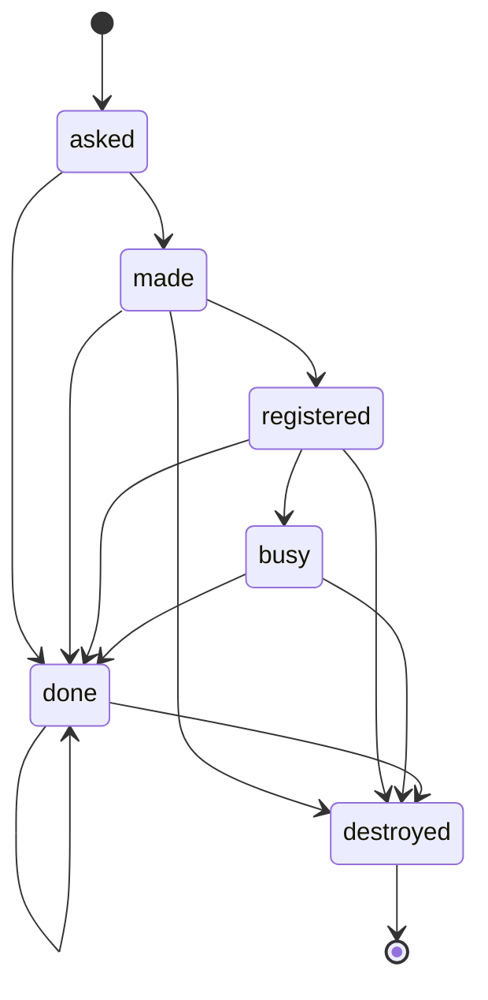

# @mark1russell7/runner-dispatch

The records, the trust rules, the check on the machine and the life of a machine of one-job CI runners. It also has the passes of a dispatcher, the GitHub source and the Proxmox provider. The package is not on npm yet.

A dispatcher gives a runner only to a job of a trusted run. This package has the data of that decision, and the function that decides. It also has the check that a machine does before the first step of a job. It has the life of a machine as a state machine. It has no network code. The GitHub source and the Proxmox provider send their requests through clients that the host gives.

## The records

| Record | What it is |
| --- | --- |
| `RunRecord` | The part of a workflow run that the policy reads: the repository, the id, the number of the try, the event, the head repository and the two actors. |
| `JobRecord` | One job of a run that waits for a runner, with the labels that it asks for. |
| `MachineRecord` | One machine that a provider makes for one job of a run. |

GitHub keeps each field of `RunRecord`. A fork cannot change them. A fork can write each label of a job, so the policy does not read a label.

## The policy

`decide(rules, run)` tells if a run is trusted. The rules are data:

```ts
import { decide, type TrustRules } from "@mark1russell7/runner-dispatch";

const rules: TrustRules = {
  repositories: ["octo/app"],
  events: ["push", "pull_request", "workflow_dispatch"],
  actors: ["octo-owner"],
};

const decision = decide(rules, {
  repository: "octo/app",
  runId: 12345678901,
  runAttempt: 1,
  event: "pull_request",
  headRepository: "stranger/app",
  actor: "stranger",
  triggeringActor: "stranger",
});
// decision.trusted is false. decision.refusals names the rules "head-repository", "actor" and "triggering-actor".
```

A run is trusted only when all of these are true:

1. The record is complete.
2. The repository is in `repositories`.
3. The event is in `events`.
4. The event is not `pull_request_target` or `workflow_run`. The policy refuses these two events, also when the rules list them.
5. The head repository is the repository. Thus the policy does not trust a run from a fork.
6. The actor of the run is in `actors`.
7. The actor of this try of the run is in `actors`.

The decision has each rule that refused the run, with one sentence for a log.

- The function compares the names of accounts and repositories without the case of ASCII letters, as GitHub does.
- A character that only looks like a letter is a different character.
- The function compares an event with its exact text.
- An empty list permits no run.
- The function does not throw. A record or rules with a bad shape give a run that is not trusted.

### The two refused events

A run of `pull_request_target` or `workflow_run` has the repository as its head repository. But a pull request from a fork can start it, and its workflow can read the code of the fork. Thus rule 5 does not stop it, and rule 4 does.

### The account that vouches

The rules trust an account, not a commit. When a trusted account pushes to a branch, the run has the code of that branch. The account vouches for it.

## A document of trust rules

`parseTrustRules(value)` reads a document, for example from a JSON file:

```json
{
  "format": "trust-rules/1",
  "repositories": ["octo/app"],
  "events": ["push", "pull_request", "workflow_dispatch"],
  "actors": ["octo-owner"]
}
```

The function gives the rules, or the list of the problems. It reports an unknown field and a name with a bad shape. It also reports an entry that is in a list two times, and a refused event in `events`.

## The run label

`runLabel({ runId, runAttempt })` gives the label `run-<id>-<try>` of the runner of one run. `parseRunLabel` reads only a label that `runLabel` gives.

- The dispatcher gives the label to the runner. The workflow names it in `runs-on`, so GitHub sends the jobs of that run to the runner.
- A fork can write the same label. Thus the label is not a proof.
- `sameRun(a, b)` compares the repository, the id and the try of two records. The check on the machine uses it to compare a job with its machine.

## The check on the machine

The dispatcher decides before it makes a machine. The machine decides again, before the first step of a job. The check on the machine does not use the decision of the dispatcher. Thus it stops a job that got the label of a trusted run.

`checkJob(settings, environment, event)` tells if a job can start on a machine. A job passes only when all of these are true:

1. The policy trusts the run of the job, with the record that the machine reads.
2. The event file of the job is an object, and it names the repository of the job.
3. The run of the job is the run that the machine serves.

`readJobRun(environment, event)` reads the record of the run on the machine:

| Field | Source |
| --- | --- |
| `repository` | The variable `GITHUB_REPOSITORY` |
| `runId` | The variable `GITHUB_RUN_ID` |
| `runAttempt` | The variable `GITHUB_RUN_ATTEMPT` |
| `event` | The variable `GITHUB_EVENT_NAME` |
| `actor` | The variable `GITHUB_ACTOR` |
| `triggeringActor` | The variable `GITHUB_TRIGGERING_ACTOR` |
| `headRepository` | The event file of the job |

- For a pull request, the head repository is `pull_request.head.repo.full_name` of the event file.
- An event file with the key `pull_request` is a pull request. An event with a name that starts with `pull_request` is a pull request too.
- A pull request from a fork that no longer exists has no head repository. The check refuses it.
- For each other event, the head repository is `repository.full_name` of the event file.
- An id is a text of decimal digits with no zero at the start. Each other text gives 0, and the policy refuses the record.
- The check does not expand a value. The author of a workflow writes some of the values.
- The functions do not throw. A value with a bad shape gives a job that does not pass.

### The settings of a machine

The dispatcher writes one document of settings for each machine. `parseCheckSettings(value)` reads it:

```json
{
  "format": "machine-check/1",
  "rules": {
    "format": "trust-rules/1",
    "repositories": ["octo/app"],
    "events": ["push", "pull_request", "workflow_dispatch"],
    "actors": ["octo-owner"]
  },
  "run": { "repository": "octo/app", "runId": 12345678901, "runAttempt": 1 }
}
```

The function gives the settings, or the list of the problems. The dispatcher uses it before it sends a document to a machine.

### The job-started program

The runner program starts one script before the first step of each job. The variable `ACTIONS_RUNNER_HOOK_JOB_STARTED` of the runner program names that script. On a machine of the dispatcher, the script starts the program `src/cli/job-started.ts` with one argument:

```sh
#!/bin/sh
exec /opt/actions-runner/externals/node24/bin/node \
  /opt/runner-dispatch/packages/runner-dispatch/src/cli/job-started.ts /etc/runner-dispatch/check.json
```

The argument is the path of the settings file. The program reads the event file from the path in `GITHUB_EVENT_PATH`.

- The runner program has its own Node.js in its folder `externals`. Thus the machine needs no second Node.js for the check.
- Each path of the script is absolute. Thus `PATH` does not select the Node.js or the program.
- When a file of the script is absent, the script fails, and the runner program fails the job.

| Exit code | Meaning |
| --- | --- |
| 0 | The job passed the check, and it starts. |
| 1 | The check refused the job. The log has one line for each reason. |
| 2 | The check cannot use its settings: no argument, a file that it cannot read, or a document that is not valid. |

- The runner program fails the job for each code that is not 0. Thus the check fails closed.
- The program takes the path of the settings only from its argument. No variable changes it.
- The author of a job can read the log of the job. Thus the lines do not show the trust rules.
- Each line starts with fixed words. A value from outside is in quotation marks, with an escape for each character that is not printable ASCII.
- The program needs only Node.js 24 or later and the source files of this package. It imports no package, and a test holds this.
- `jobStarted(args, environment, read)` is the program without its input and output.

### The measured sequence of the runner program

The documentation of GitHub does not state when the job-started script starts, or which variables it gets. A probe measured these facts for the runner program 2.338.2 on Linux:

- The script is the second step of a job. It comes before each image pull, each container and each step of the job.
- When the script fails, the runner program skips them and fails the job.
- The key `env` of a workflow or of a job gives no variable to the script. Thus a job cannot change the input of the check.
- A job cannot change which script the runner program starts.
- The script gets the environment of the runner program. It gets no token of the job.

Then two probes started this program as the script, on the same runner program. The program was that of the commit `648bb37`:

| Settings of the machine | Result |
| --- | --- |
| The run of the job, with rules that trust it | The program gave the code 0 in 114 ms. Each step of the job started. |
| A different run, with rules that do not list the event of the job | The program gave the code 1 in 123 ms, with one line for each of the two rules. The job failed in its second step, and no step started. |

- The runner program 2.338.2 has Node.js 24.22.1 in its folder `externals/node24`. This Node.js started the TypeScript file with no flag and no package.
- The lines of the program are in the log of the job, in the step "Set up runner".
- The two times are those of a GitHub-hosted machine.

No probe measured the runner program on Windows or on macOS. A new version of the runner program can change the sequence, or the folder of its Node.js. Thus these probes must pass for each new version of the runner program, and for each change of this program.

## The life of a machine

The dispatcher makes one machine for each job, and it destroys the machine after the job. `MACHINE_LIFECYCLE` is the life of one machine, as data. It is a document in the format `mark1russell7.machine/1` of [`@mark1russell7/algebra`](https://www.npmjs.com/package/@mark1russell7/algebra). The document is the specification: the functions of this package read it, and the dispatcher follows it.



| State | Meaning |
| --- | --- |
| `asked` | The dispatcher asked the provider for the machine. |
| `made` | The machine operates, and its runner is not connected to GitHub. |
| `registered` | The runner of the machine is connected to GitHub, and it has no job. |
| `busy` | The runner does its one job. |
| `done` | The machine has no more work, and the dispatcher asks the provider to destroy it. |
| `destroyed` | The provider tells that the machine is not there. |

### The transitions

| Transition | From | Event | To | Request |
| --- | --- | --- | --- | --- |
| `made` | `asked` | `provider.made` | `made` | |
| `registered` | `made` | `runner.registered` | `registered` | |
| `started` | `registered` | `job.started` | `busy` | |
| `completed` | `busy` | `job.completed` | `done` | `provider.destroy` |
| `failed` | `asked`, `made`, `registered`, `busy` | `provider.failed` | `done` | `provider.destroy` |
| `no-job` | `asked`, `made`, `registered` | `job.none` | `done` | `provider.destroy` |
| `stopped` | `asked`, `made`, `registered`, `busy` | `stop` | `done` | `provider.destroy` |
| `make-late` | `asked` | `timer.make` | `done` | `provider.destroy` |
| `register-late` | `made` | `timer.register` | `done` | `provider.destroy` |
| `idle-late` | `registered` | `timer.idle` | `done` | `provider.destroy` |
| `job-late` | `busy` | `timer.job` | `done` | `provider.destroy` |
| `destroy-again` | `done` | `timer.destroy` | `done` | `provider.destroy` |
| `lost` | `made`, `registered`, `busy` | `provider.destroyed` | `destroyed` | |
| `destroyed` | `done` | `provider.destroyed` | `destroyed` | |

- `provider.made`, `provider.failed` and `provider.destroyed` are reports of the provider.
- `runner.registered`, `job.started`, `job.completed` and `job.none` are reports of GitHub.
- `job.none` tells that the run has no job for this runner: each job ended, another runner has it, or the runner has no registration.
- `stop` is the stop switch of the dispatcher.
- The dispatcher asks the provider to destroy the machine at each transition into `done`.
- A state ignores each event that is not in its rows.
- No transition goes back, and only `destroyed` is final. Thus a life ends only in `destroyed`.
- A machine goes to `destroyed` only when the provider tells that the machine is not there.

### The timers

Each state that is not final has one timer. The timer starts at the entry to the state, and each other event that leaves the state cancels it.

| State | Timer | Wait | Event |
| --- | --- | --- | --- |
| `asked` | `make` | `make` | `timer.make` |
| `made` | `register` | `register` | `timer.register` |
| `registered` | `idle` | `idle` | `timer.idle` |
| `busy` | `job` | `job` | `timer.job` |
| `done` | `destroy` | `min(retry * pow(2, min(fired, 32)), retry_max)` | `timer.destroy` |

- Before `done`, the firing of a timer sends the machine to `done`. Thus no machine stays in a working state.
- In `done`, each firing asks the provider again. Each wait is two times the wait before it, to the longest wait.
- The waits of `done` have no end. Thus the dispatcher does not forget a machine when the provider fails.
- The dispatcher sees a firing at the first pass of its loop after the wait. Thus each timer can fire one pass late.

### The times of a machine

`parseMachineTimes(value)` reads a document of the times, for example from a JSON file. Each time is in seconds:

```json
{
  "format": "machine-times/1",
  "make": 300,
  "register": 120,
  "idle": 180,
  "job": 21600,
  "retry": 5,
  "retryMax": 300,
  "pass": 10
}
```

| Field | Meaning |
| --- | --- |
| `make` | The longest time for the provider to make a machine. |
| `register` | The longest time for the runner of a machine to connect to GitHub. |
| `idle` | The longest time that a connected runner waits for its job. |
| `job` | The longest time of a job. |
| `retry` | The first wait before the dispatcher asks the provider again to destroy a machine. |
| `retryMax` | The longest wait before the dispatcher asks again. It is not less than `retry`. |
| `pass` | The longest time between two passes of the loop of the dispatcher. |

- The function gives the times, or the list of the problems.
- Each time is a number above 0 and not above 31 536 000, which is 365 days. Thus each timer has an end.
- The document has no default. The numbers of this example are not a recommendation: measure the times of your provider.

### The functions

```ts
import { advance, due, longestLife, parseMachineTimes, startLife, waitOf } from "@mark1russell7/runner-dispatch";

const parsed = parseMachineTimes(document); // The document of the example above.
if (!parsed.ok) throw new Error(parsed.problems.join(" "));
const times = parsed.times;

// The dispatcher asks the provider for a machine at the time 0. Each time of a life is in milliseconds.
let life = startLife(0);
life = advance(life, "provider.made", 40_000)?.life ?? life;
// life is { state: "made", at: 40_000, fired: 0 }.

// At each pass of its loop, the dispatcher asks if the timer of the state fires.
const event = due(life, 170_000, times);
// event is "timer.register": the machine is in "made" for 130 s, and the time register is 120 s.
const step = event === null ? null : advance(life, event, 170_000);
// step.transition is "register-late", step.life.state is "done", and step.actions is ["provider.destroy"].

waitOf("done", times, 3);
// { timer: "destroy", fires: "timer.destroy", low: 40_000, high: 50_000 }: the fourth wait of the state done.

longestLife(times);
// { withJob: 22_240_000, withoutJob: 630_000 }
```

| Function | What it gives |
| --- | --- |
| `startLife(at)` | The life of a new machine, in the state `asked`. |
| `advance(life, event, at)` | The transition of the document, with the life after it and its requests. It gives `null` when the state ignores the event. |
| `waitOf(state, times, fired)` | The wait of the timer of a state: the time of the wait, and that time plus one pass. |
| `due(life, now, times)` | The event of the timer of the state when its wait ended, or `null`. |
| `longestLife(times)` | The longest times from the request for a machine to the end of its work. |

- A life is a value: `advance` gives a new life, and it does not change its input.
- The clock of a life does not go back. A service uses a monotonic clock for it.
- `@mark1russell7/algebra` calculates each wait from the document, with exact arithmetic.
- `waitOf`, `due` and `longestLife` throw a `RangeError` for times that `parseMachineTimes` refuses.
- These functions give no loop and no clock. `createDispatcher` takes a clock, and the dispatcher service has the loop.

### The longest life

The work of a machine ends at its entry to `done`. `longestLife(times)` gives the longest time from the request to that entry:

| Machine | Longest time |
| --- | --- |
| A machine that gets a job | `make + register + idle + job + 4 * pass` |
| A machine that gets no job | `make + register + idle + 3 * pass` |

The function does not have these formulas. It finds the longest path of the document, with each timer one pass late. Thus a change of the document changes the result.

### A recorded life

The function `replay` of the entry `@mark1russell7/algebra/replay` examines a recorded life against the document. A record has one line for each transition: the state before, the event, the state after and the time. The function reports each line that the document does not permit.

## The dispatcher

A dispatcher joins a source of jobs, the policy and a provider of machines. Its work is a sequence of passes. One pass reads the facts, makes a plan and sends the requests of the plan.

### The settings of a dispatcher

The settings are a JSON document with the format `dispatch-settings/1`. `parseDispatchSettings` reads the document, and `settingsProblems` gives each problem as one sentence. The document has no default.

```json
{
  "format": "dispatch-settings/1",
  "prefix": "rd",
  "capacity": 3,
  "sizes": ["small", "large"],
  "standard": "small"
}
```

| Field | Value |
| --- | --- |
| `prefix` | The first part of each machine name: a small letter, then 15 small letters or digits at most. |
| `capacity` | The largest count of machines at one time, from 1 to 1000. |
| `sizes` | The size classes of the provider. A name starts with a small letter, and it is not a run label. |
| `standard` | The size of a job that names no size. It is one of the sizes. |

- `machineName(prefix, run, suffix)` gives the name `<prefix>-<id of the run>-<try>-<suffix>`. The suffix is 8 digits of base 16.
- The runner of a machine has the name of the machine. `parseMachineName` reads only a name that `machineName` gives for the prefix.
- Give a different prefix to each dispatcher of one repository or of one provider.
- `runnerLabels(label, size)` gives the labels of a runner: the run label and the size.
- `sizeOfLabels` gives the size that a job asks for. A job names the run label, and one size at most.
- A job with a different label gets no machine. The report of the pass tells it with the reason `label`.

### The two ports

A host gives the dispatcher two ports. `JobSource` is the source of the jobs, for example GitHub. `MachineProvider` is the provider of the machines, for example a hypervisor.

| Method | Work |
| --- | --- |
| `source.view(repository, runs, signal)` | It gives the runs of a repository that are not completed, and the runner registrations of its scope. |
| `source.register(request, signal)` | It makes a runner registration for one job. It gives the id and the one-job configuration. |
| `source.remove(repository, runnerId, signal)` | It removes a registration. It succeeds when the registration is not there. |
| `provider.make(request, signal)` | It asks for a machine. It ends when the provider accepts the request, before the machine operates. |
| `provider.machines(signal)` | It gives each machine of the dispatcher, with its record and its status. |
| `provider.destroy(name, signal)` | It asks the provider to destroy a machine. It succeeds when the machine is not there. |

- A method throws when it cannot give a complete answer. The dispatcher then has no fact, and it does not decide from a part of a list.
- A view has each registration of the dispatcher. A machine with no job whose runner is not in the view goes to `done`.
- A view can name its `scope`, for example an organization. Two views with the same scope show the same registrations. A view with no scope has the registrations of its repository.
- The provider keeps the record of each machine. A dispatcher that starts again reads the run of a machine from it.
- A port reads its signal. The dispatcher cannot stop a request that does not read the signal.
- A port limits the rate of its own requests. The dispatcher sends the requests of one pass together.
- The one-job configuration is a credential for one use. The dispatcher gives it only to the provider.

### The plan

`plan(state, seen, config)` is the decision of one pass. It reads the memory and the facts of the pass, and it has no effect.

- The memory has the life of each machine, and the count of failed machines of each run. `EMPTY_STATE` is the memory of a new dispatcher.
- The facts are the time, the stop switch, the view of each served repository and the machines of the provider.
- A fact that the pass did not read is `null`. It gives no event, and no machine starts from it.
- The plan adopts each machine of the provider that the memory does not have.
- Each life gets the events that the facts show, in the sequence of the document `MACHINE_LIFECYCLE`.
- A machine goes to `done` when it stopped, the stop switch is on, the policy does not trust its run, or its timer fires.
- The plan asks for one machine for each queued job of a trusted run, less the machines of the run that wait for a job.
- A run with more machines than queued jobs loses the machines with no connected runner, the newest first.
- The plan removes each registration of the dispatcher that has no job and no machine that works.
- The plan removes a registration of a scope one time, also when each view of the scope shows it.
- In a named scope, the plan keeps the registration of a machine whose repository has no view in the pass. The life of the machine decides at a later pass.
- The runs get machines in turn, the oldest run first, to the capacity.

A queued job that gets no machine in a pass is in the list `waits`, with one of these reasons:

| Reason | Cause |
| --- | --- |
| `trust` | The policy does not trust the run. The text has each refusal. |
| `label` | The job names a label that is not the run label or a size of the settings. |
| `stop` | The stop switch is on, or the dispatcher cannot read it. |
| `provider` | The provider gave no list of its machines. |
| `backoff` | A machine of the run failed before a job, and the wait before the next request did not end. |
| `capacity` | The dispatcher has its largest count of machines. |

### A pass

```ts
import { createDispatcher } from "@mark1russell7/runner-dispatch";

const dispatcher = createDispatcher({ rules, times, settings, source, provider, now, suffix, stopped });
const report = await dispatcher.pass(signal);
```

1. The pass reads the stop switch, the machines of the provider and the view of each repository of the trust rules.
2. The pass makes the plan.
3. The pass removes registrations and destroys machines. The two groups of requests start together.
4. The pass makes a registration for each new machine, then it asks the provider for the machine.

- A request that fails is in the list `failures` of the report. The pass does not throw for it, and the next pass tries again.
- The text of a failure has no one-job configuration. Thus a log can keep each report.
- The field `cut` is `true` when the signal stopped the pass before each request started.
- `createDispatcher` throws a `RangeError` for trust rules, times or settings that are not valid.
- The dispatcher keeps its memory only in the process. After a new start, the first pass adopts each machine of the provider.
- With the stop switch on, a pass makes no machine, and it asks the provider to destroy each machine.
- With a stop switch that the pass cannot read, a pass makes no machine and destroys no machine for the switch.

The tests found these limits. They are properties of the run label, not defects of a pass:

- A job that names only the run label can go to a runner of each size of its run.
- A run from a fork can write the run label of a trusted run. Its job can take the runner of that run.
- The check on the machine then refuses the job, and no step starts. The trusted job waits for the next machine.

### The measures

`noteReport` adds the report of one pass to the measures. It is a function with no effect. It gives the record of each machine at the end of its life, and of each job at its end.

```ts
import { EMPTY_MEASURES, jobSpans, machineSpans, noteReport } from "@mark1russell7/runner-dispatch";

let measures = EMPTY_MEASURES;
const note = noteReport(measures, report);
measures = note.state;
for (const record of note.machines) log(record, machineSpans(record));
for (const record of note.jobs) log(record, jobSpans(record));
```

- A record `machine-measure/1` has the times of the request, the operation, the connection of the runner, the job, the end of the work and the end of the machine.
- A record `job-measure/1` has the times that the views showed the job in the queue, started and complete.
- A dispatcher sees an event only in a read. Thus each time is a `Moment`: the event came from `after` to `at`.
- `after` is the start of the last read that did not show the event. `at` is the end of the reads of the pass that showed it.
- The time of an act of the dispatcher is exact. Examples are the request for a machine and a timer.
- `machineSpans` gives the bounds of the start time, the boot time, the idle time, the job time, the teardown time and the life of a machine.
- `jobSpans` gives the bounds of the queue time and the run time of a job.
- The report of a pass gives the facts: `read`, `listed`, `viewed`, `jobs` and `asked`.

A property test on the fake world holds the bounds. It has random times, slow reads, failed reads and new starts of the dispatcher. Each true time is in its bounds.

- The bounds are correct when each view shows each run that is not complete, as the port `JobSource` states.
- The memory of the measures is only in the process. After a new start, the record of an adopted machine has no time of its request.

### The fake world

The entry `@mark1russell7/runner-dispatch/testing` has a source and a provider for tests, on one clock.

```ts
import { countingSuffix, fakeWorld } from "@mark1russell7/runner-dispatch/testing";

const world = fakeWorld({ clock, times: { boot: 2000, connect: 1000, destroy: 500 } });
world.addRun(run, [{ labels: ["run-100-1"], duration: 3000 }]);
```

- A machine of the world boots, connects its runner, takes one job of its labels, and stops after the job.
- The world starts the check on the machine before each job, with the settings that the dispatcher gave.
- `faults` makes a request fail: `refuse` has no effect, and `lose` has the effect and loses the answer.
- `cancelRun`, `lose` and `halt` cancel a run, remove a machine and stop a machine.
- `jobs()`, `runners()`, `machines()`, `events()`, `peak()` and `secrets()` give the state of the world to a test.
- `countingSuffix` gives the suffixes `00000000`, `00000001` and the subsequent numbers. Thus the names of a test are known.
- `fakeGitHubApi(world, { pageSize })` is a fake REST API of GitHub on the world. Its lists have pages of `pageSize` items at most.
- The option `organizations` names the organizations of the world. A runner of an organization takes a job of each repository of the organization.

## The GitHub source

The entry `@mark1russell7/runner-dispatch/github` has a source on the REST API of GitHub. Its runners register on a repository or on an organization.

```ts
import { createGitHubSource } from "@mark1russell7/runner-dispatch/github";

const source = createGitHubSource({ api });
```

`api` is a client of the REST API. Its one method `request(request, signal)` gives the status and the JSON body of the answer. The client has these tasks:

- It adds the credential and the version of the API to each request.
- It sends a conditional request when it has an answer with an `ETag`. For the status 304, it gives the stored answer with the status 200.
- It limits the rate of its requests, and it waits after a refusal for the rate.
- It throws only when it gets no answer. Each status is an answer.

The client `createRestClient` goes to `@procedures/gh`, the package of the calls of the GitHub API.

### The requests of a view

| Request | Count in one view |
| --- | --- |
| `GET /repos/{repository}/actions/runs?status={status}` | One for each status of `OPEN_RUN_STATUSES`: `queued`, `in_progress`, `requested`, `waiting` and `pending`. |
| `GET /repos/{repository}/actions/runs/{run}` | One for each named run that is not in the lists. |
| `GET /repos/{repository}/actions/runs/{run}/attempts/{try}/jobs` | One for each open run. |
| `GET /repos/{repository}/actions/runners` | One. |

Each list has pages of 100 items. A longer list needs one request for each page.

- A run in two lists is one run, with its newest try. GitHub starts a new try only after the try before it is completed.
- A named run that is completed or not there (404) is not in the view. A named run with a newer try is in the view with the newer try.
- A job with the status `waiting`, `requested` or `pending` does not wait for a runner yet. The view does not show it.
- A field of the policy that the answer does not give is the empty text. The policy refuses such a run.
- The view throws for a list that changed between its pages, and for a list of more than 1,000 runs. GitHub gives 1,000 runs at most for a list with a status.
- The view throws for a job status that it does not know and for a run of a different repository. It also throws for a job of a different run and for a runner with no busy field.
- The source examines each repository name before it puts the name in a path. `.` and `..` are not names.

### The requests for a runner

| Request | Answer that the source accepts |
| --- | --- |
| `POST /repos/{repository}/actions/runners/generate-jitconfig` with `name`, `runner_group_id` and `labels` | 201, with the runner id and the one-job configuration |
| `DELETE /repos/{repository}/actions/runners/{id}` | 204, or 404 for a runner that is not there |

- The runner group is 1, the default group of a repository. The option `runnerGroup` changes it.
- The text of an error has the status of the answer, and no part of its body. Thus a one-job configuration does not go to a log.
- The source refuses a registration whose answer has a different runner name.

### The runners of an organization

```ts
const source = createGitHubSource({ api, organization: "octo", runnerGroup: 3 });
```

- With the option `organization`, the runners register on the organization. Each served repository is a repository of the organization.
- The runner requests then go to `/orgs/{organization}/actions/runners`. The runs stay the runs of each repository.
- Each view then has the field `scope` with the value `organization:<name>`. `organizationScope(name)` gives it, with small letters.
- The source refuses a repository of a different owner before it sends a request.
- A runner of an organization can take a job of each repository that its runner group admits.
- A job of a different run can name the run label of the runner. The check on the machine then refuses the job.

### The check of a runner group

`checkRunnerGroup(api, organization, runnerGroup, rules, signal)` reads a runner group of an organization and the repositories of the group. It gives `{ pass, problems }`.

- The group names its repositories. GitHub gives such a group the visibility `selected`.
- The group names each repository of `rules.served`, and no other repository.
- The group admits no public repository. `rules.publicRepositories` set to `true` permits public repositories.
- `judgeRunnerGroup(facts, rules)` gives the same decision from the answers, with no request.
- A problem names a repository or a visibility from the answer. It has no other part of the answer.
- Item R5 adds the program of the service. The program does the check before its first pass, and it stops when the check fails.

### The rate of the requests

The REST API of GitHub has two limits that a dispatcher meets:

- The primary limit is 5,000 requests an hour for a token of a person or of a GitHub App. A conditional request with the answer 304 does not count.
- The secondary limit is 900 points a minute. A `GET` costs 1 point, and a `POST` or a `DELETE` costs 5 points. The documentation does not tell the cost of an answer 304.

One pass for `r` repositories sends `G = 6r + o + n` requests `GET` when each list has one page. Here `o` is the count of the open runs. `n` is the count of the runs that the dispatcher names and the lists do not have. A pass each `p` seconds then uses `60 G / p` points a minute, and each registration and each removal adds 5 points.

For example, 40 repositories with no open run give `G = 240`. A pass each 16 seconds then uses the full limit of 900 points a minute. Thus such a dispatcher needs a longer period, or a token for each group of repositories.

With an organization, each view also lists the runners of the organization. Thus `G` stays the same. One list of the organization runners for each pass is an open point of the roadmap.

### What the source does not do yet

- A test with a real credential measures the smallest permissions and the cost of an answer 304.
- The same test measures the labels that GitHub adds to a one-job runner, and the runner group of a repository.
- It also measures if an organization on the Free plan can limit its default runner group to selected repositories.

## The Proxmox provider

The entry `@mark1russell7/runner-dispatch/proxmox` has a provider on the API of Proxmox VE. Each machine is a linked clone of the template of its size, in one pool.

```ts
import { createProxmoxProvider } from "@mark1russell7/runner-dispatch/proxmox";

const provider = createProxmoxProvider({
  api,
  pool: "runners",
  sizes: { small: { node: "pve1", template: 9000, cores: 2, memory: 4096 } },
});
```

`api` is a client of the API. Its one method `request(request, signal)` gives the status, the message and the data of the answer. The client has these tasks:

- It adds an API token in the header `Authorization`. A request with a token needs no CSRF token.
- It sends the parameters of a `POST` or a `PUT` as a form body, and the other parameters in the query.
- It trusts the certificate authority of the cluster.
- It throws only when it gets no answer. Each status is an answer.

### The client of the API

The entry `@mark1russell7/runner-dispatch/proxmox-client` has a client of this kind on a transport port. The transport sends one HTTP exchange.

```ts
import { createProxmoxClient } from "@mark1russell7/runner-dispatch/proxmox-client";

const api = createProxmoxClient({ url: "https://pve.example:8006", token, transport });
```

- The token has the form `USER@REALM!TOKENID=SECRET`. The client sends it in the header `authorization: PVEAPIToken=<token>`.
- The URL has the scheme `https`, a host and a port, and no user, path, query or fragment.
- The client encodes each part of a path, and it refuses the parts `.` and `..`. A task id keeps its characters `:` and `@`.
- The parameters of a `GET` or a `DELETE` go in the query. The parameters of a `POST` or a `PUT` go in a form body. The client sorts them by name.
- The message of an answer is the reason phrase of the status line. Proxmox VE puts the text of an error there.
- The data of an answer is the field `data` of the JSON body. A body of a status 2xx that is not JSON is not an answer, thus the client throws.
- No error text and no message has the token. The client replaces it with `[token]`, and it cuts a message to 500 characters.
- The client uses no type of a platform: no `URL` and no `fetch`. Thus it operates on each runtime.

The transport sends the exchange with no change, and it does not follow a redirect. The program of `@runner-dispatch/dispatcher` has a transport on Node.js.

### The steps of a machine

| Step | Request | The provider waits for |
| --- | --- | --- |
| Make | `GET /cluster/nextid`, then `POST /nodes/{node}/qemu/{template}/clone` with `newid`, `name`, `pool` and `description` | The task of the clone |
| Size | `PUT /nodes/{node}/qemu/{vmid}/config` with `cores`, `memory` and `tags` | The answer |
| Start | `POST /nodes/{node}/qemu/{vmid}/status/start` | The task of the start, then the guest agent |
| Delivery | `POST /nodes/{node}/qemu/{vmid}/agent/file-write`, first for the settings of the check, then for the configuration | The answer |
| Tag | `PUT /nodes/{node}/qemu/{vmid}/config` with the tag `delivered` | The answer |
| Destroy | `POST /nodes/{node}/qemu/{vmid}/status/stop`, then `DELETE /nodes/{node}/qemu/{vmid}` with `purge` and `destroy-unreferenced-disks` | The task of the stop, then the task of the delete |

- `make` sends only the clone. Each call of `machines` reads the pool with `GET /cluster/resources?type=vm`, and it does the next step of each machine.
- The description of the VM is the record of its machine, as the JSON document `runner-machine/1`. Thus a new provider reads the record of each machine again.
- A machine is `operating` only when it has the tag `delivered`. The provider adds the tag after the two file writes. Thus after a restart, a running machine with no tag is `stopped`.
- The configuration goes in the body of one request: the file write to its path. No problem text and no error text has a part of it.
- A destroy of a machine that is not there succeeds. The provider accepts a repeated destroy in each step.

### The faults

| Fault | What the provider does |
| --- | --- |
| A different client takes the VMID before the clone | It tries a new VMID, eight times at most. |
| The clone, the size or the start fails | The machine is `stopped`, and the provider tells the problem. The dispatcher then destroys it. |
| The template has no guest agent | The machine stays `making`, and the provider tells it one time. The timer of the life of the machine ends it. |
| The machine stops before its delivery | The machine is `stopped`. It gets no configuration. |
| A file write fails | The provider tries it again at the next list. The problem text has only the status of the answer. |
| An operator removes the VM | The machine is not in the list. |
| Two VMs of the pool have the name of one machine | The provider keeps the VM of its record, and it tells the problem. |
| A VM of the pool has no record of a machine | The provider does not change it and does not show it. It tells it one time. |

### Why the guest agent, and not cloud-init

A cloud-init file of Proxmox VE is a snippet on a storage of the host. The API cannot write a snippet: its upload accepts only the types `iso`, `vztmpl` and `import`. Thus a snippet needs a different route to the host, and it stays on the disk of the host. The guest agent writes the file into the guest, with one request of the API.

### The template

The provider does not make the template. Each template obeys these rules:

- It is a template of Proxmox VE, outside the pool. Thus the token cannot change it or delete it.
- It has the option `agent: 1`, and its image starts `qemu-guest-agent`.
- It does not have the tag `delivered`. The provider removes such a tag from a clone.
- The image makes the folder `/run/runner-dispatch` at each start. `/run` is a file system in memory, so the configuration does not go to a disk.
- A path unit of systemd watches `/run/runner-dispatch/configuration`. Its service reads the file, removes it and starts the runner with it.
- The job-started program reads its settings from `/run/runner-dispatch/check.json`.
- The image stops the machine after its one job. It also stops the machine after a limit of time with no job.

The option `files` of the provider changes the two paths.

### The privileges of the token

Give these privileges to the token and to its user. A token with separate privileges gets only the privileges that its user also has.

| Path | Privileges | Why |
| --- | --- | --- |
| `/pool/{pool}` | `VM.Allocate`, `VM.Audit`, `VM.Config.CPU`, `VM.Config.Memory`, `VM.Config.Options`, `VM.PowerMgmt`, `VM.GuestAgent.FileWrite`, `VM.GuestAgent.Audit`, `Pool.Audit` | The clones and their steps |
| `/vms/{template}` | `VM.Clone`, `VM.Audit` | The source of each clone |
| `/storage/{storage}` | `Datastore.AllocateSpace` | The disks of the clones |
| `/sdn/zones/{zone}/{bridge}` | `SDN.Use` | The network bridge of the clones |

- These privilege names are the names of Proxmox VE 9. Proxmox VE 8 has no `VM.GuestAgent.*` privileges. There, `VM.Monitor` replaces the two, and it also permits each other command of the guest agent.
- A clone joins the pool only at the end of its task. Thus the provider keeps the task of each clone, and it reads the task with no privilege on the VM.
- A stolen token can make, change, stop and delete the VMs of the pool, and write files into them. It cannot touch a VM outside the pool.

### What the provider does not do yet

- A test on a real host measures the steps, the privileges and the times. The program of the service is in `@runner-dispatch/dispatcher`.

## The tests

Property tests on `fast-check` hold the rules of the policy:

- A run from a fork is not trusted, for each value of the other fields.
- The two refused events are not trusted, also when the rules list them.
- The function agrees with a second statement of the rules.
- A list that loses entries adds no trust.
- A value of each type gives no trust and no error.

Tests hold the check on the machine:

- A pull request from a fork does not pass, for each value of the other fields.
- The job of a different run does not pass.
- The check passes no job that the policy of the dispatcher refuses.
- The check agrees with a second statement, from the facts of a job.
- Two machines with different rules write the same lines when the same rules refuse a job.
- A test starts the program as a process, and it gets the exit codes 0, 1 and 2.
- The program imports only files of this package and modules of Node.js.

Tests hold the life of a machine:

- The document has no problem in the checks of `@mark1russell7/algebra`, and its schema accepts the document.
- The document agrees with a second statement of each state and each event.
- No transition goes back, and each path of the document ends in `destroyed`.
- A loop with random reports and random times records each life. Each record replays on the document with no problem.
- In that loop, the work of each machine ends in the longest life.
- A machine that gets no report goes to `done` by its timer. Then the dispatcher asks the provider again after each wait.
- The tables and the diagram of this file agree with the document.

Tests hold the dispatcher:

- A property test holds the rules of a plan for each memory and each set of facts.
- On the fake world, each served job of a trusted run ends one time, also after a new start of the dispatcher.
- No machine starts for a run that the policy does not trust, and no step of a job of that run starts.
- A machine does only a job of its run, and the count of machines is not more than the capacity.
- After the requests stop to fail, each served job ends, and no machine and no registration stays.
- After the pass that reads the stop switch on, no machine starts, and no machine stays.
- No report and no failure text has a one-job configuration.

Tests hold the GitHub source:

- On the fake world, the GitHub source gives the view of the fake source at each pass. The pages of the fake API have 1 to 4 items.
- A dispatcher on the GitHub source does each served job one time, and no step of a job of a fork starts.
- Tests with written answers hold each refusal: a bad shape, a list that changed, a count that does not agree and an unexpected status.
- No error text has a part of the body of an answer.
- The source sends no request for a repository name that is not valid, and no request after the signal stops.

Tests hold the Proxmox provider, on a fake API of Proxmox VE:

- A machine is `operating` only after the two files in the guest have their exact text.
- The configuration is only in the body of the file write to its path.
- Each fault of the table of the faults has a test.
- A new provider shows a delivered machine as `operating`, and a different machine as `stopped`.
- A property test does random steps: makes, lists, ticks, destroys, stops, removals and failed tasks.
  - Each configuration goes only to its own machine, and no problem text has a part of it.
  - The provider changes no VM outside its own machines, and it changes the template only by a clone.
  - After a destroy of each machine, the pool has only the VM of a different owner.
- Four changes of the provider make the tests fail: no write of the configuration, no tag check, no stop check and no tag removal.

Tests hold the client of the API:

- Each method puts its parameters in the correct place, with the token in a header.
- A property test sends random paths and parameters through a wire. The fake Proxmox VE reads the same path and the same parameters.
- A property test holds the form encoding. For each code unit and each lone surrogate, the body agrees with `URLSearchParams`.
- No error text and no message has the token.
- The provider makes, delivers and destroys a machine on the fake Proxmox VE through the client and the wire.
